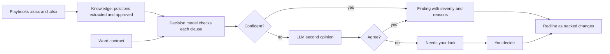

<div align="center">

# Rivell

**Your intelligent redlining partner**

A contract review workbench that checks Word contracts against your playbook and returns a tracked-change redline.

[](LICENSE)


[](https://github.com/Shridhar600/Rivell/actions/workflows/ci.yml)

<!-- Demo GIF: add .github/assets/rivell-demo.gif, then restore:  -->

</div>

## What Rivell does

Rivell is a contract review workbench. You give it your playbook and a Word contract, and it checks every clause against your positions. Findings come with a severity and the reasons behind them, and approved fixes go back into your original file as tracked changes. A lawyer stays in control.

## Features

**Knowledge**

- Import playbooks from `.docx` or `.xlsx` files.
- Rivell finds each position, tags its topic and extracts its fields.
- You approve positions before they are used.
- Contradictions between positions in different playbooks are flagged.

**Review**

- For each clause and each position that applies, the decision model answers one fixed question: does the clause meet the position, fall within the fallback, go beyond it, or hit a walk-away point? The answer comes with a confidence.
- When the decision model is unsure, an LLM gives a second opinion.
- When the two disagree, the finding goes to "needs your look" instead of being decided for you.
- If no topic matches a clause, hybrid search falls back to full text plus vectors, merged by rank.
- A whole-contract read catches issues outside the playbook.
- Every finding shows the clause, the position it was checked against, who decided it (the decision model, the second opinion or you) and why.

**Human control**

- Accept, reject or edit each finding.
- Add an issue Rivell missed.
- Every change is saved as a new review version.
- Finalize the review to freeze its decisions for redline.

**Redline**

- Approved changes are written as tracked changes into your original file.
- The replacement text comes from your approved drafting first, then generated text, then your own edits.
- Four checks verify the file before you download it.

## How it works



- **Knowledge.** Upload your playbooks, approve the positions Rivell extracts, and review contradiction flags.
- **Decision.** For each clause and each position that applies, the decision step uses Jev, the System-1 decision model from [TypeSafe](https://typesafe.ai), and answers with a confidence.
- **Second opinion.** When the decision model is unsure, an LLM gives a second opinion. When the two disagree, the item goes to "needs your look" and you decide.
- **Search.** If no topic matches a clause, hybrid search finds the closest positions and the decision model judges them.
- **Redline.** Approved fixes become tracked changes in your original Word file, after four checks.

## Quick start

Rivell has no sign-in yet. It runs with one fixed local user. **Do not expose it to the internet.**

You need Java 21, Node 22 or later, and Docker.

```bash
# 1. Database (PostgreSQL with pgvector)
cd backend
docker compose up -d

# 2. Backend on http://localhost:8080
export TYPESAFE_API_KEY=...        # decision model (Jev, typesafe.ai)
export OPENAI_API_KEY=...          # second opinion and drafting; any OpenAI-compatible API
export OPENAI_MODEL=...            # the model to use
export RIVELL_EMBEDDINGS_PROVIDER=openai-compatible   # vectors for hybrid search
export RIVELL_EMBEDDINGS_API_KEY=...                 # any OpenAI-compatible embeddings API
export RIVELL_EMBEDDINGS_MODEL=text-embedding-3-small
export RIVELL_JOB_WORKER_ENABLED=true
./mvnw spring-boot:run

# 3. Frontend on http://localhost:5173
cd ../frontend
cp .env.example .env
npm ci
npm run dev
```

Notes:

- **Embeddings.** Rivell was measured with embeddings on. A local Ollama works too; see `backend/src/main/resources/application.properties`. Without embeddings, search falls back to full text only.
- **Demo data, no keys needed.** To browse fictional demo contracts, reviews and playbooks, start the backend with `RIVELL_DEMO_SEED_ENABLED=true` and `RIVELL_JOB_WORKER_ENABLED=false`. The demo includes a queued review, which stays queued only while the worker is off.

## Configuration

Most setups only need the variables from the quick start. The full list, with defaults, is in `backend/src/main/resources/application.properties`.

| Variable | What it does |
|---|---|
| `TYPESAFE_API_KEY` | API key for the decision model. |
| `OPENAI_API_KEY` | API key for the second opinion and drafting, any OpenAI-compatible API. |
| `OPENAI_MODEL` | Model for the second opinion and drafting. |
| `RIVELL_JOB_WORKER_ENABLED` | Set to `true` to run background analysis jobs. Without it, jobs are queued but not executed. |
| `RIVELL_EMBEDDINGS_PROVIDER` | Set to `openai-compatible` for vector search. Empty means full text only. |
| `RIVELL_EMBEDDINGS_API_KEY` | API key for embeddings. A local Ollama accepts any value. |
| `RIVELL_EMBEDDINGS_MODEL` | Embeddings model name. |
| `RIVELL_DEMO_SEED_ENABLED` | Loads fictional demo contracts and playbooks. |

## Tests

```bash
cd backend && ./mvnw test        # needs Docker (Testcontainers)
cd frontend && npm run lint && npm run typecheck && npm test
```

## Tech stack

| Area | Stack |
|---|---|
| Backend | Java 21, Spring Boot 3.5, Spring Modulith, Flyway, JobRunr, docx4j, Apache POI |
| Frontend | React 19, TypeScript, TanStack Query, React Router, Vite, Vitest, oxlint |
| Data | PostgreSQL 17 with pgvector 0.8.6, via Docker Compose |
| AI | Jev decision model (TypeSafe) for clause checks; any OpenAI-compatible API for second opinions, drafting and embeddings |

## Project status

Rivell is a personal project. There is no sign-in or multi-user support, and contracts must be Word `.docx` files.

## Contributing

See [CONTRIBUTING.md](CONTRIBUTING.md).

## Security

Report security problems as described in [SECURITY.md](SECURITY.md).

## License

Copyright 2026 Shridhar600.

Rivell is licensed under the [Apache License 2.0](LICENSE).
