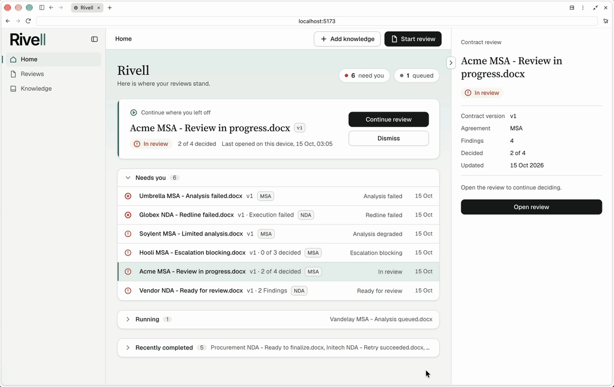
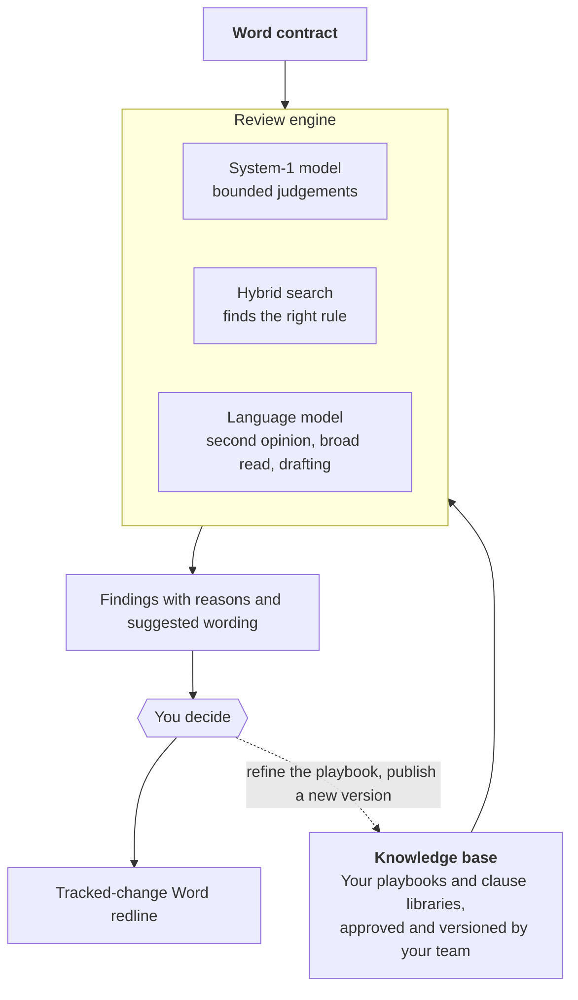

<div align="center">

# Rivell

**AI-assisted contract review and redlining, grounded in your own playbook.**

[](LICENSE)
[](https://github.com/Shridhar600/Rivell/actions/workflows/ci.yml)



</div>

Rivell reads a Word contract the way your team would: against your own playbook. It points out where the contract departs from your positions, explains why, suggests wording, and turns the changes you approve into a tracked-change Word redline. The lawyer decides every change; Rivell does the reading and the drafting work.

It has two halves that work together:

- **A knowledge base.** Your playbooks and clause libraries, read into positions (preferred, fallback, walk-away), approval rules and approved wording, checked by your team and published as fixed versions.
- **A review engine.** A hybrid of a System-1 decision model, hybrid search and a large language model, each used where it is strongest, so the review is precise, explainable and inexpensive to run.

## What Rivell does

- **Reviews against your positions, not generic rules.** Every clause is compared with the playbook positions that govern it. A finding shows what the contract says, your rule, the gap and a suggested change.
- **Knows who has to approve.** Rivell reads approval rules from your playbook, its approval matrix and approval tables, and names the approver and the condition when a finding needs sign-off.
- **Suggests wording you already trust.** Approved clause-library wording is offered first, but only when it fits your position and closes the gap. Otherwise Rivell drafts new wording and checks it against the position before showing it.
- **Reads the whole contract, too.** Issues that no single playbook rule covers are still raised, each quoting the contract word for word.
- **Says when it is unsure.** When two independent assessments disagree, the clause comes to you with both views instead of a guess.
- **Delivers a clean redline.** Approved changes become tracked changes in a new Word file. Your original is kept untouched, and the redline is verified before you download it.
- **Keeps a record.** Every review is tied to the knowledge version it used, and every decision, approval and change is kept.

## What it works with

| | |
|---|---|
| **Contracts** | Word (`.docx`) in English: NDAs (mutual and one-way), MSAs, SaaS agreements, DPAs, statements of work, software licences, supply, services and reseller agreements, order forms, amendments, and other commercial contracts |
| **Knowledge** | Playbooks and clause libraries in Word (`.docx`) or Excel (`.xlsx`) |
| **Scope** | Each playbook can apply to chosen contract types, and to a jurisdiction such as the US, UK, Australia, Canada, Ireland, India, New Zealand, Singapore, Hong Kong, Germany, France or the Netherlands |
| **Governing law** | Read as the contract writes it, for example "New South Wales" or "State of Wisconsin" |

## How it works



Rivell gives each step to the tool that can do it most reliably:

- **Plain code where the text is explicit.** Parsing the Word file, reading labelled playbook fields such as "Fallback:" or "Approver:", finding the governing law, setting severity and writing the redline are deterministic. No model guesses what the document already states.
- **A System-1 decision model for bounded judgements.** Questions with a fixed set of answers ("does this clause meet the preferred position, fall within a fallback, or cross the walk-away?", "does this wording fit?") go to a fast, low-cost decision model that answers with calibrated probabilities. Code, not the model, owns the thresholds, so every decision can be traced.
- **Hybrid search when no rule obviously applies.** When no playbook position obviously addresses a clause, full-text and vector search over your published positions find candidates. The decision model then confirms that a found rule really governs the clause before it is used.
- **A language model where reading is open-ended.** A second opinion when the decision model is unsure, a whole-contract read for issues outside the playbook, and drafting new wording. Drafted wording is checked again by the decision model before you see it.
- **You, where they disagree.** Disagreements and uncertain calls come to you with both views. Nothing is changed in your contract without your decision.

The knowledge base only changes when your team changes it. Corrections are made by people and published as a new version; each review keeps the version it started with.

## Where your documents go

Rivell is self-hosted. Contracts and knowledge are stored in your own PostgreSQL database and local file storage. Clause text is sent to the model providers you configure: the System-1 decision model ([Jev by TypeSafe](https://typesafe.ai)) and any OpenAI-compatible API for the language model and, optionally, embeddings.

## Try the demo

The demo loads fictional contracts, playbooks and reviews in every state, from waiting to a verified redline. It needs no API keys.

You need Java 21, Node `^22.22.2` or `>=24.15`, and Docker.

```bash
# 1. Database
cd backend
docker compose up -d

# 2. Backend with demo data on http://localhost:8080
RIVELL_DEMO_SEED_ENABLED=true ./mvnw spring-boot:run

# 3. Frontend on http://localhost:5173 (in a second terminal)
cd frontend
cp .env.example .env
npm ci
npm run dev
```

Open http://localhost:5173. To start over, run `docker compose down -v` and start again. Keep the background worker off for the demo (the default), so the waiting review stays waiting.

## Run it with your own contracts

Use the same three steps, and give the backend your model keys and a running background worker:

```bash
cd backend
docker compose up -d
export TYPESAFE_API_KEY=...                 # System-1 decision model
export OPENAI_API_KEY=...                   # language model, any OpenAI-compatible API
export RIVELL_JOB_WORKER_ENABLED=true       # runs the analysis
# Optional: vector search alongside full-text search
export RIVELL_EMBEDDINGS_PROVIDER=openai-compatible
export RIVELL_EMBEDDINGS_API_KEY=...
export RIVELL_EMBEDDINGS_MODEL=text-embedding-3-small
./mvnw spring-boot:run
```

Then start the frontend as in the demo. Add a playbook under **Knowledge**, approve and publish it, then **Start review** with a Word contract.

### Configuration

| Variable | Required | Default | What it does |
|---|---|---|---|
| `TYPESAFE_API_KEY` | yes | | Key for the System-1 decision model |
| `OPENAI_API_KEY` | yes | | Key for the language model |
| `OPENAI_BASE_URL` | no | `https://api.openai.com/v1` | Any OpenAI-compatible endpoint |
| `OPENAI_MODEL` | no | `gpt-6-luna` | Language model name |
| `RIVELL_JOB_WORKER_ENABLED` | yes, for reviews | `false` | Runs queued analyses; without it reviews stay waiting |
| `RIVELL_EMBEDDINGS_PROVIDER` | no | empty (full-text only) | `openai-compatible` turns on vector search |
| `RIVELL_EMBEDDINGS_API_KEY`, `RIVELL_EMBEDDINGS_MODEL` | with embeddings | | Embeddings key and model; a local Ollama works too |
| `RIVELL_DATASOURCE_URL` | no | `jdbc:postgresql://localhost:5432/rivell` | Database |
| `RIVELL_DEMO_SEED_ENABLED` | no | `false` | Loads the fictional demo data |
| `VITE_API_PROXY_TARGET` (frontend `.env`) | no | `http://localhost:8080` | Where the frontend sends API calls |

Everything else has a sensible default; see `backend/src/main/resources/application.properties`.

## Status and limits

Rivell is an early, personal open-source project.

- No sign-in or multi-user support yet: it runs as one local user. **Do not expose it to the internet.**
- Word `.docx` contracts only, in English.
- Needs a laptop or larger screen.
- A fallback that meets only some of its conditions can still read as acceptable, and a protection missing from the contract altogether is not always raised. Read the whole contract; Rivell assists, it does not sign off.

## Development

```bash
cd backend && ./mvnw test                                   # needs Docker
cd frontend && npm run lint && npm run typecheck && npm test
```

Built with Java 21, Spring Boot, React, TypeScript, PostgreSQL with pgvector, docx4j and Apache POI.

See [CONTRIBUTING.md](CONTRIBUTING.md) to contribute and [SECURITY.md](SECURITY.md) to report a security problem.

## License

Copyright 2026 Shridhar600. Licensed under the [Apache License 2.0](LICENSE).
